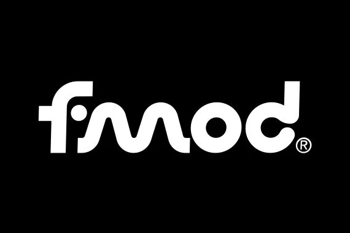

<div align="center">
  
</div>

**WARNING**: This Gem is due for a rewrite, we don't recommend using this gem just now.

# FMOD Studio for O3DE AudioSystem.

This gem provides a _(non-functional)_ AudioSystem implementation for O3DE using FMOD Studio, this gem also aims to be simpler in their asset pipelines
for soundbanks and individual audio streaming files, removing the need to generate settings, special dependency files generated through
scripts separatedly, as well to be fully multiplatform in both runtime and authoring.

**NOTE:**: Users wil need to download FMOD Engine SDK from [FMOD website](https://www.fmod.com/download), extract and set the FMOD SDK root folder
in CMake under the `FMOD_ROOT` variable, or set an environment variable called `FMOD_HOME` in your system.

## Installing "generateO3DEProjectInfo.js"

In order to keep separated the FMOD project and from the O3DE project, is needed to install an small .js script to your FMOD Studio Tool, the script is located at Scripts/generateO3DEProjectInfo.js.
This script generates an JSON file you can copy into O3DE FMOD Enabled project at Assets/Audio/FMOD next to your banks, this file will be read by the Audio Controls Editor giving you the available
events, snapshots and parameters to use.

In linux you can copy the script like this:

```bash
cp Scripts/generateO3DEProjectInfo.js ~/.config/fmod-studio/Scripts/
```

in Windows just copy said file to `%localappdata%/FMOD Studio/Scripts/`, copy that address to your Windows File Explorer Address Bar.

Alternatively you can copy the script to your FMOD project directory at the /Scripts/ directory.

An new menu called "O3DE FMOD AudioSystem" should now appear in your Scripts menu.
